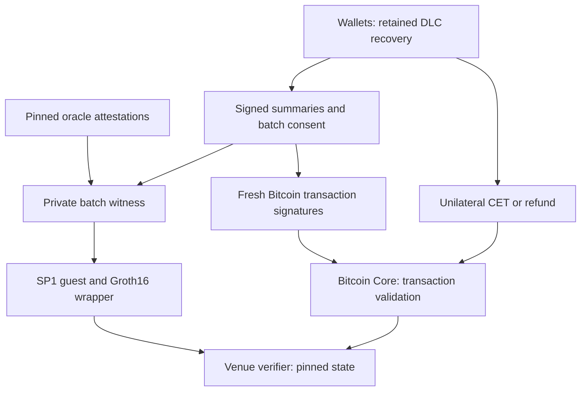

# LN Markets: private DLC batches

This prototype checks a batch of privately exchanged DLC summaries and binds
the agreed payouts to one exact unsigned Bitcoin transaction. Both parties
sign each summary and give fresh consent to the batch. The shared Rust
relation checks those signatures, selected oracle outcomes, collateral
conservation and a replay-state transition, then emits a **276-byte journal**.

The implementation is an isolated application experiment requested for this
repository. The default `rust-bitcoin-zk-adapter` crate keeps its existing
dependencies and scope. This folder has its own Cargo workspaces, with an
optional SP1 backend compiled separately.

**Current evidence:** native execution over deterministic regtest fixtures.
The SP1 guest, host and local runner prepare the next prover experiment.
Consult [VALIDATION.md](VALIDATION.md) for the commands that ran and their
results. A native journal certifies no zkVM execution; obtaining a private
proof requires running and verifying the final Groth16 wrapper.

## What LN Markets could integrate

A venue can keep its order and quote system while adding wallet-held DLC
recovery material and a batch coordinator. For each accepted position, the
wallets retain the original plan and recovery pins. They sign the new summary
after checking the actual package. When an oracle event matures, the
coordinator proposes an exact settlement batch and collects fresh consent.
An internal verifier checks the proof against its previously accepted batch
manifest and advances the consumed-authorization root atomically.

This is a proposed interface. It has no access to LN Markets' production
backend and provides no migration of existing customer balances. The source
relationship and integration requirements are recorded in
[PROTOCOL.md](PROTOCOL.md) and [SOURCES.md](SOURCES.md).



The proof certifies an agreed proposal. Spending the collateral requires
valid Bitcoin witnesses for that transaction. The original per-contract
recovery path stays available while the batch remains unconfirmed.

## Implemented relation

| Check | Binding |
| --- | --- |
| Two-party summary consent | BIP340 signatures on a salted, domain-separated summary covering the funding outpoint, keys, scripts, payout root, oracle event, timeouts and original package digests |
| Funding template | Derivation of the UTXORef NUMS-keyed Taproot output with the two-party CET leaf and CSV refund leaf |
| Selected payout | SHA-256 Merkle membership for an indexed outcome plus two distinct signatures from the three pinned oracle keys |
| Amounts | Checked integer arithmetic; each row's trader payout, maker payout, anchor and fee sum to its committed collateral |
| Exact batch consent | Fresh signatures from both parties over the complete batch context, exact transaction digest and old/new authorization roots |
| Replay state | Full-depth 256-bit sparse Merkle nonmembership and insertion for each funding outpoint, with sequential roots |
| Accepted set | Canonically ordered, unique outpoints and an exact commitment to every submitted summary |
| Receiver context | Comparison with independently retained epoch, batch ID, selected-contract root, old root, transaction digest and height window |

The guest accepts 1–32 rows and at most 512 KiB of witness bytes. It emits a
fixed binary journal. Identical payout scripts are aggregated into one
transaction output; the transaction still needs one input per funding UTXO.
Every input's Bitcoin spending witness remains part of the final transaction.

## Run the native example

From the repository root with Rust installed:

```sh
cargo test --locked --manifest-path LNMarkets/statement/Cargo.toml --all-targets
cargo run --locked --release --manifest-path LNMarkets/statement/Cargo.toml --bin lnm-native -- demo --rows 1 --out LNMarkets/.local/native-1
cargo run --locked --release --manifest-path LNMarkets/statement/Cargo.toml --bin lnm-native -- verify --witness LNMarkets/.local/native-1/witness.bin --journal LNMarkets/.local/native-1/journal.bin
python3 LNMarkets/scripts/local_prover.py
```

`demo` also supports 2, 8 and 32 rows. It writes a private witness, the public
journal, an unsigned transaction and a JSON report. Its deterministic keys,
salts, funding references and oracle signatures exist for reproducible tests.
They are public fixtures and carry no real funds.

The Python command prints the local proving plan. Execution requires an
explicit action and `--run`. See [SP1 setup](sp1/README.md) for toolchain pins,
ELF and verification-key review, execution, resumable compressed proofs and
the later Groth16 run.

## Privacy and compactness

The fixed journal publishes the selected batch count, collateral totals,
fee total, context, state roots and transaction commitments. Private rows
include keys, scripts, payout paths and signatures. The coordinator that
builds the witness can read those rows. A verified hiding wrapper is needed
to keep them from other proof recipients.

SP1 documents that its individual STARK proofs currently lack the required
zero-knowledge property; its Groth16/PLONK wrappers provide that property.
This implementation uses Groth16 as the explicit final mode, with the
associated setup and verifier assumptions. Compressed intermediates and
prover checkpoints belong with the private witness. See
[SP1's security model](https://docs.succinct.xyz/docs/sp1/security/security-model).

The measured native witness sizes and 276-byte journal describe application
data. Final proof bytes, proving time, peak memory and verifier cost require
the later run. Bitcoin inputs, script witnesses and chain-visible output
values remain visible when the transaction is broadcast. Public transaction
commitments also allow observers to link a journal to a known transaction.

## Taproot and Shinigami path

The first implementation directly checks the application signatures and
derives the fixed Taproot funding template with mature curve primitives.
Existing single-contract `SIGHASH_DEFAULT` signatures commit to their
original transaction. A batch therefore needs fresh transaction signatures;
[BIP341](https://github.com/bitcoin/bips/blob/master/bip-0341.mediawiki)
defines the binding to the inputs and outputs.

[Shinigami](https://github.com/starkware-bitcoin/shinigami) provides a Cairo
Bitcoin Script engine. The repository's [M17 experiment](../integrations/bitvm3-nova/m17/README.md)
implements legacy/P2SH/witness-v0 execution and lists Taproot as remaining
work. A future composition can verify an exact Taproot spending statement
and a chain/prevout statement against the same transaction digest. Each
component needs a pinned verifier identity and an explicit statement.

## Next implementation gates

1. Build the SP1 6.9.0 guest and host from their pinned lockfiles, review the
   ELF digest and program key, and compare guest execution with the native
   journal for one and two rows.
2. Run one local Groth16 proof, record resources and verify it in a separate
   process using independently retained program and journal pins. Increase
   the batch size only after examining those measurements.
3. Connect a wallet-owned exporter to UTXORef's actual package validator,
   then obtain fresh summary and batch signatures through the real signer
   boundary. The existing package digests are opaque references in this
   relation.
4. Rehearse fresh Bitcoin batch signing on regtest, including aborted
   signing, transaction rejection, refund races and reorgs. Define the
   venue's reservation/cancellation policy for consumed authorizations.
5. Compose funding/chain and Taproot spend evidence once their precise
   relations and verifier interfaces are available. Evaluate acceleration
   patches and recursion against measured cost and privacy requirements.

The native statement and SP1 guest use the repository's
[MIT license](../LICENSE). The optional SP1 host declares GPL-3.0-only and
includes its [license text](sp1/host/LICENSE), following the existing
`nb3-prover` integration it can link through its `resumable` feature.
